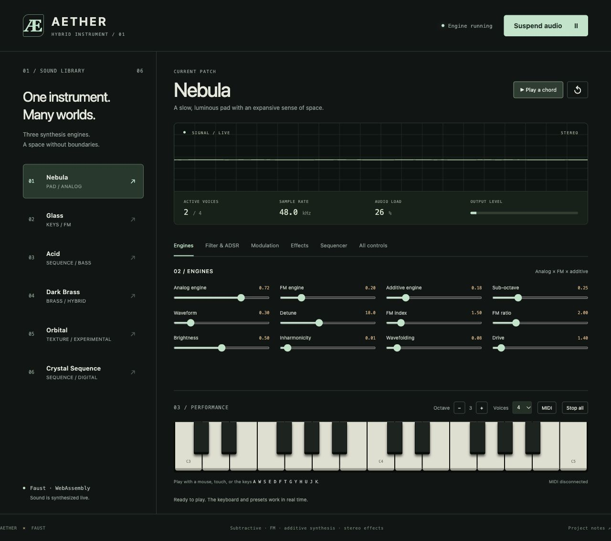

# Aether — hybrid synthesizer in Faust

An ambitious polyphonic instrument written entirely in Faust: subtractive
synthesis, four-operator FM, additive synthesis, a modulation matrix,
a 16-step sequencer, and a stereo effects bus. No samples or external plugins.
The project includes source code, six presets, demo renders, and reproducible
offline tests with **faustprobe**.



## Listen and test

From this directory:

```sh
make help                      # help; running make alone shows the same list
make demo                      # renders/aether-demo*.wav, 20 seconds, nebula preset
make demo PRESET=crystal_sequence SECONDS=24
make test                      # test-results/summary.json and detailed results
make params                    # per-voice controls
faustprobe --double -I . --list-params effects.dsp # shared effect bus controls
```

Requirements: `faust`, its standard libraries, `faustprobe`, and Python 3.
The Python scripts only use the standard library. The raw render is a float64
WAV; a `*-preview.wav` copy in PCM16, normalized to −1 dBFS, is also produced
for convenient listening. Normalization happens after faustprobe measurements
and is not part of the DSP.

```sh
make test FAUST=/usr/local/bin/faust FAUSTPROBE=/usr/local/bin/faustprobe
# Alternative engine available on the development machine:
make test FAUST=/Users/letz/faust/build/bin/faust \
  FAUSTPROBE=/Users/letz/faust/tools/faustprobe/faustprobe
```

The identity check requires a compiler whose `--version` output includes
`Source commit:`. The report also records executable SHA-256 hashes because
faustprobe does not expose its own `Source commit:` line.

## Play in real time

The main instrument exposes the conventional Faust controls `freq`, `gain`,
and `gate`. A polyphonic host allocates voices and sums their two outputs.
The `effect` definition then runs **once** on that mix. Metadata requests
12 voices; a host may choose a different voice count.

For a CoreAudio/Qt/MIDI application on macOS, with the required dependencies:

```sh
faust2caqt -midi -nvoices 12 -effect auto aether.dsp
```

For a standalone audition without a keyboard, `audition.dsp` combines a
regularly retriggered voice with the effects. It starts immediately.
Enable `sequencer` to vary its pitch. To render offline:

```sh
faustprobe --double -I . --in zero --set sequencer=1 \
  -n 480000 --sr 48000 --out renders/sequence.wav audition.dsp
```

A polyphonic chord example (MIDI pitches, positions measured in samples):

```sh
faustprobe --double -I . --in zero --nvoices 12 \
  --chord '45,52,57,60,64:100@0..96000' \
  --sr 48000 -n 384000 --fail-above 0.921 \
  --out renders/chord.wav aether.dsp
```

Running `aether.dsp` directly in monophonic mode produces the dry voice.
The host must extract `effect`, or use `audition.dsp`, to hear the effect bus.
`effects.dsp` exposes the same bus as a standalone two-input/two-output insert.

## Sound architecture

```text
MIDI freq / gain / gate → sequencer transposition + modulation matrix
    ├─ 7 unison oscillators, each morphing saw ↔ pulse/PWM ↔ triangle
    ├─ 4-operator FM/PM, interpolating a serial chain and parallel carriers
    ├─ 12 additive partials with spectral tilt and inharmonic stretching
    └─ sub-octave sine + pink noise
  → wavefolder + saturation + ring modulation
  → morphing resonant Moog ladder / band-pass / high-pass filters
  → amplitude ADSR + velocity + panning → stereo voice outputs

Summed voices → 3-tap/channel chorus → 4-section phaser
  → filtered, saturated ping-pong delay → Zita reverb
  → mid/side width → linked stereo compression
  → bass/treble EQ + DC rejection + volume + soft clip bounded to ±0.92
```

The chorus uses modulated fractional delays with offset phases. Ping-pong
cross-feeds its two feedback paths through damping and saturation.
Its duration follows the tempo, up to two beats. Zita uses different decay
times for the bass and midrange.

Standard-library functions provide the oscillators with attenuated aliasing,
envelopes, filters, phaser, compressor, and reverb. Strong FM, wavefolding,
and saturation can introduce aliasing: this project does not implement
oversampling. Frequency ceilings and partial fades limit high-frequency
content without claiming to eliminate aliasing.

## Modulation matrix

Eight routes: `Voice/Modulation/Route_0` through `Route_7`. Each has `source`,
`destination`, and `depth` (−1 to +1). Contributions are summed.
The first two routes are active by default: LFO1 to the filter and LFO2
to a subtle pitch modulation.

| Source | Signal |
| --- | --- |
| 0 | Disabled |
| 1 | Sine LFO1, 0.01–25 Hz |
| 2 | Triangle LFO2, 0.01–30 Hz |
| 3 | Filter ADSR |
| 4 | Percussive modulation envelope |
| 5 | Velocity mapped to −1…+1 |
| 6 | Sequencer transposition divided by 72 |
| 7 / 8 | Macro1 / Macro2 |

| Destination | Scale for a contribution of +1 |
| --- | --- |
| 0 | Disabled |
| 1 | Pitch: +12 semitones |
| 2 | Filter: +4 octaves |
| 3 | FM index: +8 |
| 4 | Oscillator morph: +1 |
| 5 | Panning: move toward the right |
| 6 | Amplitude: multiplier 1 + modulation, clamped to 0…2 |

For example, animate FM with a macro:

```sh
faustprobe --double -I . --nvoices 8 --note '60:100@0..88200' \
  --set Route_2/source=7 --set Route_2/destination=3 --set Route_2/depth=0.8 \
  --at 22050 macro1=1 --at 66150 macro1=0 \
  -n 176400 --quiet aether.dsp
```

The sequencer advances at four steps per beat. Its sixteen transpositions
are editable (`note_0`…`note_15`); `sequence_octaves` multiplies those intervals
by 0, 1, 2, or 3. `step_gate` sets the held fraction of each step.
It modulates the gate of a held MIDI note; after note-off, only the release
remains. Steps and LFOs are free-running, without a reset on every note-on.

## Presets

Values live in `presets/patches.json`. A host must apply them to the controls;
this file is not a preset menu embedded in the DSP.

| Preset | Character |
| --- | --- |
| `nebula` | Unison pad, slow attack, chorus, and a long spacious tail |
| `glass` | Inharmonic FM/additive bell with reverb |
| `acid` | Resonant sequence, distortion, and delay |
| `dark_brass` | Synthetic brass with a rising filter envelope |
| `orbital` | Metallic texture, ring modulation, phaser, and echoes |
| `crystal_sequence` | Hybrid FM/additive arpeggio with dotted-eighth delay |

## Validation and limitations

`tests/test_aether.py` checks that patches produce audible, finite stereo
signals, levels stay bounded, idle/released voices return to silence, and
effect tails continue after voices stop. It tests twelve voices, voice
stealing, filters, matrix sources/destinations, extreme MIDI notes, five
sample rates, and single/double precision. Separate voice/effect tests check
block sizes 1/7/512, reset, and determinism. Before trusting the comparator,
a reference sample is deliberately altered and must cause a failure.

To compare actual samples from the two installed engines:

```sh
python3 tests/compare_engines.py /usr/local/bin/faustprobe \
  /Users/letz/faust/tools/faustprobe/faustprobe
```

Exact commands and measurements are recorded in the local `TEST_REPORT.md`
and ignored `test-results/` outputs. These are instrument tests, separate
from Faust compiler regression gates: no compiler source is modified.
The checks do not prove correctness for every possible control combination.

This instrument is computationally demanding: all three engines and effects
keep computing even at zero volume/mix. The delay uses two fixed-size buffers
(1,048,576 samples each) to support 192 kHz at slow tempos. The host controls
polyphony. Offline tests do not guarantee real-time performance; measure
load in the intended host.

## Export to Rust or C++

```sh
make rust       # generated/voice.rs and generated/effects.rs
make cpp        # generated/voice.cpp and generated/effects.cpp
```

Exports are Faust DSP classes: their host must handle audio, MIDI, voices,
and the shared bus. This project does not include a complete Rust audio host.
Generated files, renders, and test results are ignored by Git.

## Web version

```sh
make web                      # compile voice + stereo bus to WebAssembly
make web-check                # WASM vs faustprobe + 6 polyphonic presets
make web-serve                # http://127.0.0.1:8088/web/
# Another port: make web-serve PORT=8090
```

`faust-rs` produces the WASM modules, following the approach used in
`/Users/letz/Developpements/RUST/faust-coopiano`. A recent Node.js is required
for `web-check`. The interface has no npm dependencies and loads no external
resources. Serve it over local HTTP: `file://` does not reliably support
loading the modules and AudioWorklet.

Click **Enable audio**, then **Play a chord**, or use the virtual keyboard.
Six cards recall presets and restore defaults for unspecified controls.
The **MODIFIED** badge tracks edits; ↺ restores the selected preset.
Its name is remembered locally. Tabs expose engines, ADSR/filters, eight
modulation routes, effects, sixteen steps, and all remaining controls.

Play with mouse, touch, or physical key positions `A W S E D F T G Y H U J K`
(the printed letters depend on the keyboard layout). Octave is adjustable;
polyphony is selectable between 4, 8, and 12 voices. The web version starts
with four voices to limit the load of this complex DSP. **Stop all** resets
voices and effects; Escape does the same. Stolen voices fade over one block
before reassignment.

The MIDI button requests Web MIDI inputs without SysEx. Availability depends
on the browser; Chrome/Edge are generally suitable. No microphone is requested.
A physical MIDI keyboard still needs verification with your hardware.
The waveform and load/voice/level indicators reflect the running engine,
without silently triggering background notes.

`web/faust-wasm-dsp.js` is adapted from the `faust-coopiano` loader and retains
its WASM contract and math imports. The voice engine, processor, interface,
and presets are specific to Aether. Native and web versions use the same
Faust sources; only the polyphonic host changes.

## JUCE plugin

```sh
make juce-export              # faust2juce -nvoices 12 -effect auto -midi → generated/juce/aether
make juce JUCE_DIR=~/JUCE     # AU, VST3 and standalone in generated/juce/build/Aether_artefacts
make juce-run                 # build and open the standalone application
make juce-snapshot            # play a chord offscreen, render each tab to test-results/juce
```

`faust2juce` writes the processor (`FaustPluginProcessor.cpp`, polyphonic voice
plus the shared `effect` bus) and its `.jucer`. Instead of Projucer, the
project builds with `juce/CMakeLists.txt` and JUCE 8. Without `JUCE_DIR`, CMake
downloads JUCE 8.0.10. Pass `-DAETHER_INSTALL_PLUGINS=ON` to copy the AU and
VST3 to `~/Library/Audio/Plug-Ins` after each build.

`juce/patch_processor.py` makes a few anchored edits to the export. It swaps the
generic Faust interface for the editor in `juce/Source`, which is modelled on
the web version: preset library, scope and telemetry, tabbed controls with
envelope curves, a routing table and a drawable step sequencer, and a keyboard.
It also fixes two bugs in Faust's `JuceParameterUI.h` that this editor exposes:
host parameters never report their current value (`getValue` is not
overridden), and floats are quantised to 0.01 because the JUCE constructor used
ignores the Faust step. Presets come from `presets/patches.json`, compiled in.
The effect bus publishes its own copy of `bpm`, so the editor moves both
together. Computer keys `A W S E D F T G Y H U J K` play when the keyboard has
focus. Not yet checked in a DAW: host MIDI, automation and state recall.
